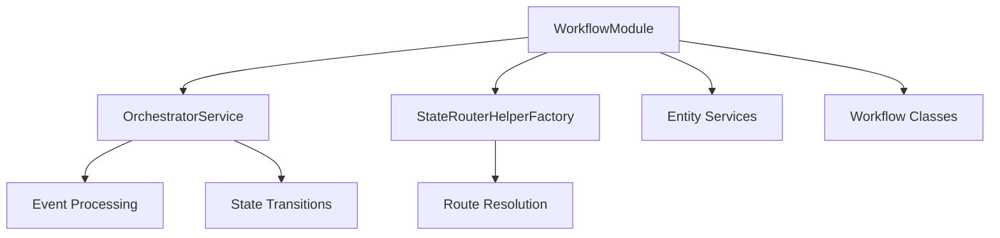

## Import

```typescript
import { WorkflowModule } from 'nestflow-js/core';
```

## Static Methods

### `register(options)`

Registers the workflow module with the provided configuration.

#### Parameters

```typescript
WorkflowModule.register({
  imports?: any[];                    // Optional NestJS modules to import
  entities: Provider<IWorkflowEntity>[]; // Entity service providers
  workflows: Provider[];               // Workflow class providers
  payloadValidator?: PayloadValidator;  // Optional schema validation function
  providers?: Provider[];              // Additional providers
})
```

Each workflow's `entityService` token must resolve to an `IWorkflowEntity` implementation. The orchestrator checks for `claimTransition()` during initialization.

#### Returns

Returns a `DynamicModule` that can be imported into your NestJS module.

#### Example

```typescript
@Module({
  imports: [
    WorkflowModule.register({
      imports: [DatabaseModule],
      entities: [
        { provide: 'entity.order', useClass: OrderEntityService },
      ],
      workflows: [OrderWorkflow],
    }),
  ],
})
export class OrderModule {}
```

## Transition telemetry

Implement `WorkflowTelemetry` and register the plugin under `WORKFLOW_TELEMETRY` from `nestflow-js/core`:

```typescript
WorkflowModule.register({
  entities,
  workflows,
  providers: [{ provide: WORKFLOW_TELEMETRY, useClass: MyTelemetryPlugin }],
});
```

You can also import a Nest module that exports the token. Without a provider, no plugin telemetry is sent.

`log()` receives structured facts such as a commit, receipt replay, or retry request. `trace()` receives one completed attempt with its start time, duration, and result. These records omit payloads, entity IDs, and raw errors. The orchestrator does not await the provider or pass it control of dispatch. A host that needs an active span around downstream calls can open it at the dispatch boundary.

## Transition history

Implement `WorkflowHistory` and register it under `WORKFLOW_HISTORY`. With a provider, the orchestrator builds a `WorkflowHistoryEntry` for each commit: workflow, event, event ID, URN, from and to states, outcome, attempt, commit time, and the handler error when the entity moved to its failed state. The entity service stores the entry in the receipt, and the result carries it as `history`, so durable checkpoints keep it too.

```typescript
WorkflowModule.register({
  entities,
  workflows,
  providers: [{ provide: WORKFLOW_HISTORY, useClass: MyHistory }],
});
```

`record(entry)` is optional and returns a cold Observable. The orchestrator waits for it before emitting the result, so a failure surfaces to the adapter, and redelivery replays the receipt and records the entry again. Deduplicate by URN and event ID. Omit `record()` when `list()` reads entries the host already stores, such as receipts or durable checkpoints. `list(urn, limit, cursor)` serves them back; authorize the entity first.

Entries omit the event payload unless the workflow sets `history: { payload: true }`. Payloads can hold personal data and make every receipt larger.

## Cancellation

Subscribe to `orchestrator.requestCancellation(event, urn)` to persist a stop request when the entity provider exposes `cancellation`. The `event` selects the workflow's entity provider. Requests are idempotent and must be authorized by the host. A cancelled entity rejects new claims with `WorkflowCancelledException` from `nestflow-js/exception`. An already claimed transition can finish, but once cancellation is observed the orchestrator does not emit a continuation.

## Architecture



## Exports

The module exports the following services:

- `OrchestratorService` - Main workflow orchestration service
- `StateRouterHelperFactory` - Factory for creating router helpers
- All registered entity services
- All registered workflow classes

## Related

- [OrchestratorService](/docs/api-reference/services#orchestratorservice)
- [IWorkflowEntity](/docs/api-reference/interfaces#iworkflowentity)
- [PayloadValidator](/docs/api-reference/interfaces#payloadvalidator)
