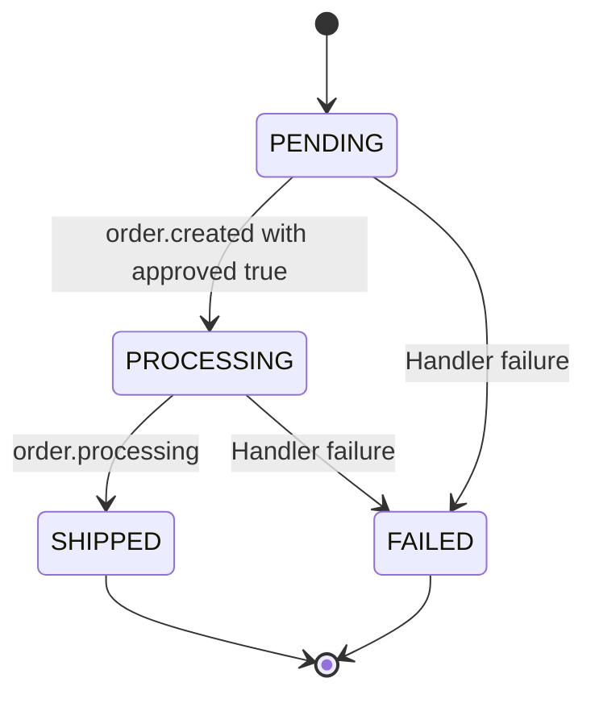

The [checked-in Lambda order example](https://github.com/tung-dnt/nestflow-js/tree/main/examples/lambda-order-state-machine) runs an order workflow on Durable Lambda. It uses DynamoDB for order state, transition claims, and completion receipts. AWS CDK deploys the table and the Lambda function with a `live` alias.

## Order transitions



`PENDING` is an idle state. If `order.created` has no approval, the adapter waits for a callback. Once approval commits, `order.processing` runs automatically. The workflow declares `CANCELLED` as a final state, but the cancellation guard in the example always rejects the transition.

The order workflow has no `@WithRetry` configuration. An ordinary handler error commits `FAILED` and propagates after one attempt. `UnretriableException` commits the same state and returns a final result. A claim conflict, validation error, or guard error does not take the handler failure path.

## Deploy and invoke

Use Node.js 26 at the version pinned in the [repository's `.node-version`](https://github.com/tung-dnt/nestflow-js/blob/main/.node-version), pnpm 12.23.0, and AWS CLI v2. Configure AWS credentials with permission to deploy to an account and region that support Durable Lambda on Node.js 26.

From the repository root, install the workspace dependencies and build the library:

```bash
pnpm install --frozen-lockfile
pnpm build
cd examples/lambda-order-state-machine
```

Set the AWS region. Bootstrap CDK if this is your first deployment to that account and region. The deploy script builds `dist/lambda.mjs` before deploying the stack.

```bash
export AWS_REGION=us-east-1
pnpm exec cdk bootstrap "aws://$(aws sts get-caller-identity --query Account --output text)/$AWS_REGION"
pnpm deploy:dev
```

Follow the [example's seed step](https://github.com/tung-dnt/nestflow-js/blob/main/examples/lambda-order-state-machine/QUICK_START.md#5-seed-and-process-an-order) to create a pending order. Use the deployed `FunctionAliasArn` as `FUNCTION_ALIAS_ARN`. Run the following invocation instead of the quick start's invocation if you want the workflow to wait for an approval callback:

```bash
aws lambda invoke \
  --function-name "$FUNCTION_ALIAS_ARN" \
  --invocation-type Event \
  --cli-binary-format raw-in-base64-out \
  --payload '{"urn":"0195146b-1ab7-7dcd-9d26-60eb422f767d","eventId":"order-created-001","initialEvent":"order.created"}' \
  output.json
```

Use a stable `eventId` from the producer. Reuse it if you deliver the same logical event again. Use another ID for any different event on that order.

The adapter logs the approval callback ID to CloudWatch. To approve the order, send `{ event: 'order.created', payload: { approved: true } }` using the [Durable Lambda callback API](/docs/plugins/durable-lambda#resuming-via-callback). Do not supply an `eventId` in the callback. The adapter derives it.

## Inspect DynamoDB storage

Read the example's [order entity service](https://github.com/tung-dnt/nestflow-js/blob/main/examples/lambda-order-state-machine/src/order/order-entity.service.ts) for the complete `claimTransition` implementation. The lease lets another worker recover an abandoned claim. The commit checks ownership and writes the order snapshot and receipt atomically. After takeover, the earlier owner cannot commit. The expiry checks use caller timestamps, not a DynamoDB server clock.

A worker can stop after a handler calls an external service but before the transition commits. A later worker can then rerun the handler. Use `@EventId()` to make external side effects idempotent. See [retry and error handling](/docs/recipes/retry-and-error-handling#make-side-effects-idempotent).

## Remove the stack

From `examples/lambda-order-state-machine`, destroy the dev stack. This deletes the DynamoDB table and the stored orders and receipts:

```bash
pnpm destroy
```
