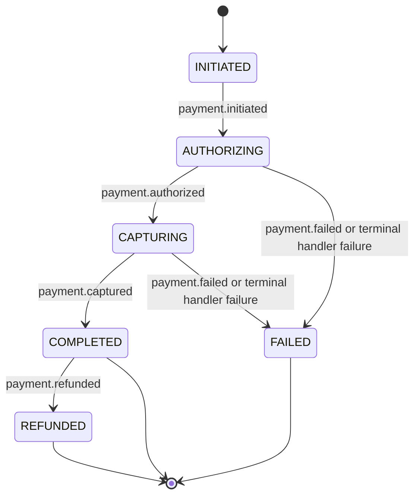

## Payment transitions



`INITIATED`, `AUTHORIZING`, and `CAPTURING` are idle states. The adapter waits for input before each next step. `COMPLETED`, `FAILED`, and `REFUNDED` end the current run. A later `payment.refunded` event can start another run for a completed payment.

See the [payment workflow fixture](https://github.com/tung-dnt/nestflow-js/blob/main/test/e2e/workflows/payment-processing/payment.workflow.ts) for the state and event definitions.

## Configure the payment handlers

Use `@WithRetry` for authorization and capture. Throw `UnretriableException` when the provider declines a payment. The example below assumes an injected payment gateway that accepts an idempotency key and returns a decline or an authorization code.

```typescript
import { Entity, EventId, OnEvent, RetryStrategy, WithRetry } from 'nestflow-js/core';
import { UnretriableException } from 'nestflow-js/exception';

@OnEvent('payment.authorized')
@WithRetry({
	handler: 'handleAuthorized',
	maxAttempts: 3,
	strategy: RetryStrategy.EXPONENTIAL_JITTER,
	initialDelay: 500,
	maxDelay: 10000,
})
async handleAuthorized(@Entity() payment: Payment, @EventId() eventId: string) {
	const result = await this.paymentGateway.authorize(payment, {
		idempotencyKey: JSON.stringify([payment.id, eventId]),
	});
	if (result.status === 'declined') {
		throw new UnretriableException('Payment declined');
	}
	return { authorizationCode: result.code };
}

@OnEvent('payment.captured')
@WithRetry({
	handler: 'handleCaptured',
	maxAttempts: 3,
	strategy: RetryStrategy.EXPONENTIAL,
	initialDelay: 500,
	maxDelay: 10000,
})
async handleCaptured(@Entity() payment: Payment, @EventId() eventId: string) {
	const result = await this.paymentGateway.capture(payment, {
		idempotencyKey: JSON.stringify([payment.id, eventId]),
	});
	return { captureId: result.id };
}
```

Register a claim-aware entity service for your payment workflow. See the [complete DynamoDB order example](/docs/examples/lambda-order-state-machine#inspect-dynamodb-storage) for the storage contract. Persist only safe, serializable entity snapshots and handler outputs.

## Start a transition directly

Use `transit()` to process a single event. Use the producer's stable ID for `eventId`, and keep it unchanged on redelivery:

```typescript
import type { OrchestratorService } from 'nestflow-js/core';

function initiatePayment(orchestrator: OrchestratorService, paymentId: string, eventId: string) {
	return orchestrator.transit({
		urn: paymentId,
		event: 'payment.initiated',
		eventId,
		attempt: 0,
	});
}
```

A direct call performs one attempt. To use the retry budget above, submit the event through [Durable Lambda](/docs/plugins/durable-lambda) or a [retry-aware custom adapter](/docs/recipes/custom-adapter#retry-only-classified-handler-failures).

## Run authorization with retries

For a payment already in `AUTHORIZING`, invoke Durable Lambda with:

```json
{
  "urn": "payment-1",
  "eventId": "payment-authorization-001",
  "initialEvent": "payment.authorized"
}
```

If the gateway throws, the adapter can retry up to the configured three total attempts. The state stays `AUTHORIZING` until an attempt commits. On exhaustion, the orchestrator commits `FAILED` and propagates the error. On a decline, it commits `FAILED` immediately and the adapter returns a completed workflow result with that state.

If authorization succeeds, the workflow waits in `CAPTURING`. Submit `{ event: 'payment.captured' }` to the callback. The adapter derives the event ID and uses the capture handler's retry configuration.

## Related

- [Retry and Error Handling guide](/docs/recipes/retry-and-error-handling)
- [@WithRetry decorator](/docs/api-reference/decorators#withretry)
- [IBackoffRetryConfig](/docs/api-reference/interfaces#ibackoffretryconfig)
- [Durable Lambda retries](/docs/plugins/durable-lambda#retry-integration)
