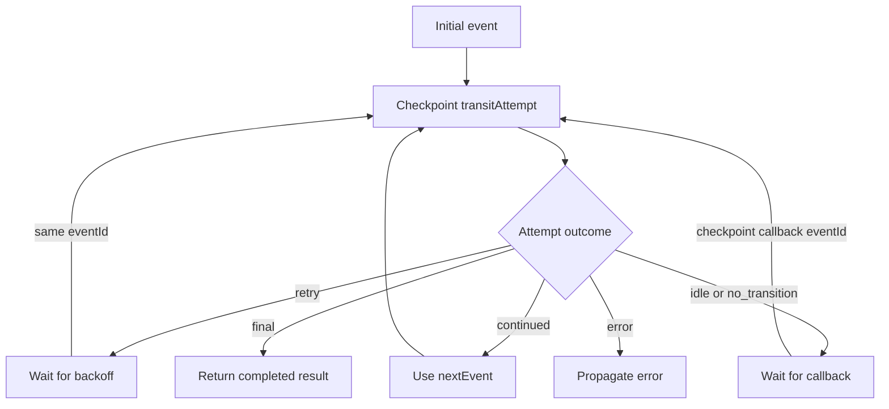

`DurableLambdaEventHandler` runs your workflow on the [AWS Lambda Durable Execution SDK](https://docs.aws.amazon.com/lambda/latest/dg/durable-execution.html). A durable execution can span multiple Lambda invocations. On replay, the SDK returns the results of completed step checkpoints.

## Setup

```typescript
import { NestFactory } from '@nestjs/core';
import { DurableLambdaEventHandler } from 'nestflow-js/adapter';
import { withDurableExecution } from '@aws/durable-execution-sdk-js';
import { AppModule } from './app.module';

const app = await NestFactory.createApplicationContext(AppModule);
export const handler = DurableLambdaEventHandler(app, withDurableExecution);
```

### Parameters
- `app`: NestJS application context containing the workflow module.
- `withDurableExecution`: The `withDurableExecution` function from `@aws/durable-execution-sdk-js`.

## Execution loop

The adapter subscribes to each `transitAttempt()` Observable with `firstValueFrom` inside `ctx.step()`. The SDK checkpoints the result, not the Observable. The adapter, not the SDK's step retry policy, controls handler retries.



`continued` supplies the next event. The adapter waits for a callback on `idle` and `no_transition`. On `final`, it returns `{ urn, status: 'completed', state }`. If the handler threw `UnretriableException`, `state` is the configured failed state.

## Initial event

Pass a `DurableWorkflowEvent` with the target entity's `urn`, the first event name in `initialEvent`, and a stable `eventId`. The event `payload` is optional:

```json
{
  "urn": "order-1",
  "initialEvent": "order.created",
  "eventId": "order-created-001"
}
```

Reuse the producer's `eventId` when you redeliver the same logical event for that entity. Do not reuse an ID for a different event on the same entity.

## Idle state callbacks

When an event leaves the workflow idle or without an automatic transition, the adapter registers a callback with `ctx.waitForCallback()`. The Lambda invocation can return while the durable execution waits for the callback.

### Resuming via callback

```typescript
import { LambdaClient, SendDurableExecutionCallbackSuccessCommand } from '@aws-sdk/client-lambda';

const lambda = new LambdaClient({});

await lambda.send(new SendDurableExecutionCallbackSuccessCommand({
  CallbackId: callbackId,  // logged by the adapter when it paused
  Result: JSON.stringify({
    event: 'order.created',
    payload: { approved: true },
  }),
}));
```

The callback result contains `event` and, if needed, `payload`. Do not provide `eventId`. The adapter checkpoints a separate ID for each callback. Replay of that callback reuses its ID, even if another execution started from the same initial event.

### Timeout configuration

The default callback timeout is **24 hours**. Configure per-state timeouts via `IdleStateEntry`:

```typescript
@Workflow({
  states: {
    idles: [
      OrderStatus.Pending,                                          // uses default 24h
      { state: OrderStatus.AwaitingApproval, timeout: { hours: 48 } },  // custom 48h
    ],
    // ...
  },
  defaultCallbackTimeout: { hours: 12 },  // override default for all idle states
})
```

## Retry integration

`@WithRetry` sets the attempt budget and backoff for a handler within one durable execution. Without it, the adapter runs one attempt. The adapter disables SDK automatic retries for transition steps. A new execution has a new budget, but a committed receipt still prevents the handler from running again for the same `eventId`.

The adapter calls `transitAttempt(event, canRetry)` with `canRetry` set to `true` only if another attempt remains. It starts another attempt only on `{ status: 'retry' }`. It waits with `ctx.wait()`, then reuses the `eventId` and increments `attempt`. The orchestrator does not advance the state or write a completion receipt for an attempt that requests a retry.

On the last attempt, a handler error commits the failed state and an exhaustion receipt, then propagates. A handler's `UnretriableException` commits the failed state and returns `final` without retrying. Validation, guard, storage, and post-commit errors propagate without an adapter retry, as do claim conflicts.

A worker can stop before commit. When the storage lease expires, a later delivery can run the handler again. Use [`@EventId()` for external side effects](/docs/recipes/retry-and-error-handling#make-side-effects-idempotent). See [failure classification](/docs/recipes/retry-and-error-handling#classify-failures) for the full behavior.

## Test with the AWS local runner

Use the [Durable Lambda order tests](https://github.com/tung-dnt/nestflow-js/blob/main/test/e2e/durable/durable-order.spec.ts) as a starting point. They use the AWS local runner and wait for callback registration before sending the result. To supply your own test context, use the exported [`IDurableContext` contract](https://github.com/tung-dnt/nestflow-js/blob/main/packages/adapter/durable-lambda.adapter.ts).

## Related

- [Adapters API](/docs/api-reference/adapters)
- [Human in the loop recipe](/docs/recipes/human-in-the-loop)
- [Custom adapter recipe](/docs/recipes/custom-adapter)
- [Lambda order example](/docs/examples/lambda-order-state-machine)
